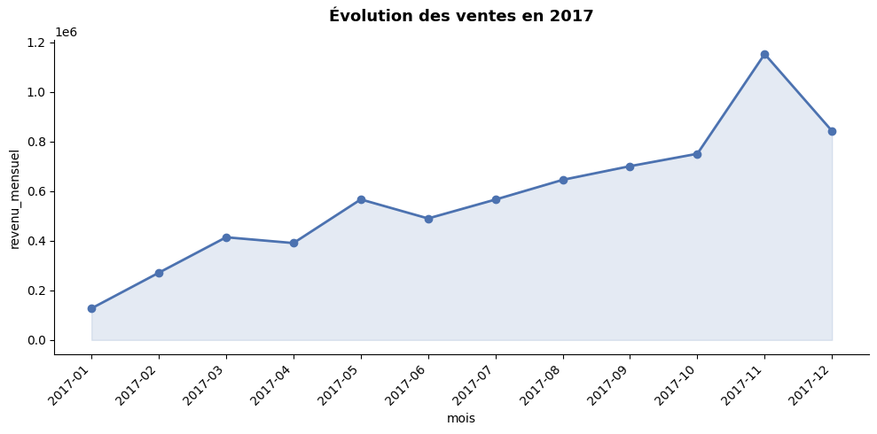
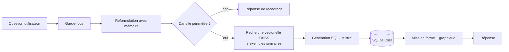

# Assistant Data Analyst e-commerce (RAG + Text-to-SQL)

Assistant conversationnel qui répond en langage naturel à des questions métier sur une base e-commerce, en **générant puis en exécutant des requêtes SQL**. Un système **RAG** retrouve des exemples question/SQL proches de la question posée pour guider le LLM et limiter les erreurs.

> Projet réalisé en équipe de 3 dans le cadre du cours de NLP moderne (Polytech Lille, IS4).

## Exemple

**Question** : `montre l'evolution des ventes en 2017`
*(reformulée automatiquement en « Quelle est l'évolution des ventes en 2017 ? »)*

| Mois    | Nombre de commandes | Revenu mensuel | Panier moyen |
|---------|---------------------|----------------|--------------|
| 2017-01 | 750                 | 127 545,67     | 159,63       |
| 2017-06 | 3 135               | 490 225,60     | 147,53       |
| 2017-11 | 7 289               | 1 153 528,05   | 151,92       |
| ...     | ...                 | ...            | ...          |

Un graphique adapté (courbe, barres, camembert) est choisi et tracé automatiquement :



Les sorties complètes sont visibles directement dans le notebook (elles proviennent d'une exécution réelle sur Google Colab).

## Fonctionnalités

- **Text-to-SQL** : le LLM ([Mistral](https://mistral.ai/), `mistral-small`) génère du SQL SQLite à partir du schéma des tables et de règles métier.
- **RAG sur des exemples** : 29 paires question/SQL vectorisées avec `all-MiniLM-L6-v2` et indexées dans **FAISS** ; les 3 exemples les plus proches sont injectés dans le prompt.
- **Mémoire conversationnelle** : les questions de suivi (« Et en 2018 ? ») sont reformulées en questions autonomes.
- **Gestion du périmètre** : les questions hors sujet (« Comment faire une pâte à crêpe ? ») sont recadrées poliment.
- **Garde-fous** : blocage des commandes destructrices (`DROP`, `DELETE`...), du SQL brut et des questions discriminatoires ; l'assistant est en lecture seule.
- **Visualisation automatique** : le LLM choisit le type de graphique le plus adapté aux résultats.

## Architecture



## Stack

Python · Mistral AI API · sentence-transformers · FAISS · SQLite · pandas · matplotlib · Jupyter / Google Colab

## Lancer le projet

### Option 1 : Google Colab (le plus simple)

1. Importer `notebooks/Projet_NLP_DataAnalyst.ipynb` dans [Colab](https://colab.research.google.com).
2. Ajouter votre clé Mistral dans les **Secrets** Colab sous le nom `MISTRAL_API_KEY`.
3. Exécuter les cellules une par une, puis appeler `talk_to_assistant("votre question")`.

### Option 2 : en local

```bash
git clone https://github.com/simon59ritz/rag-text-to-sql.git
cd rag-text-to-sql
python -m venv .venv
.venv\Scripts\activate          # Windows  (Linux/macOS : source .venv/bin/activate)
pip install -r requirements.txt

# Windows PowerShell : $env:MISTRAL_API_KEY="ta_cle"      Linux/macOS : export MISTRAL_API_KEY="ta_cle"
jupyter notebook notebooks/Projet_NLP_DataAnalyst.ipynb
```

La base de données (Olist, SQLite) est téléchargée automatiquement depuis Kaggle par le notebook (`kagglehub`) : [E-commerce dataset by Olist as an SQLite database](https://www.kaggle.com/datasets/terencicp/e-commerce-dataset-by-olist-as-an-sqlite-database). Elle n'est pas incluse dans ce dépôt.

### Clé API Mistral et plan gratuit

Une clé se crée sur [console.mistral.ai](https://console.mistral.ai). Le plan gratuit (*Experiment*) est **limité en débit** : chaque question déclenche plusieurs appels au LLM, une erreur `429` peut donc apparaître. Le notebook inclut un ralentisseur avec relance automatique ; avec un plan payant, mettre `PAUSE_ENTRE_APPELS = 0`. Le plan gratuit implique aussi que les données envoyées peuvent servir à l'entraînement des modèles : ne l'utilisez pas avec des données confidentielles.

## Structure du dépôt

```
├── notebooks/Projet_NLP_DataAnalyst.ipynb   # tout le projet (données, RAG, assistant, tests)
├── docs/exemple_graphique.png               # exemple de sortie
├── requirements.txt
├── .env.example                             # modèle de configuration de la clé API
└── README.md
```

## Limites et pistes d'amélioration

- **Base d'exemples restreinte** (29 paires) : la qualité du SQL dépend de la couverture de ces exemples. Enrichir la base et mesurer la précision sur un jeu de questions de test.
- **Garde-fous à base de mots-clés** : simples et rapides, mais contournables ; une vérification côté LLM ou une connexion SQLite en lecture seule seraient plus robustes.
- **Devise** : les données Olist sont en reais brésiliens (BRL) ; le LLM peut afficher « € » dans sa mise en forme, à corriger dans le prompt de formatage.
- **Pas d'évaluation automatique** : ajouter des tests comparant le SQL généré à des requêtes de référence.

## Auteurs

Simon Ritz, Guy Béni Ntwari, Aimable Iradukunda

## Licence

Projet académique, fourni à titre de démonstration.
